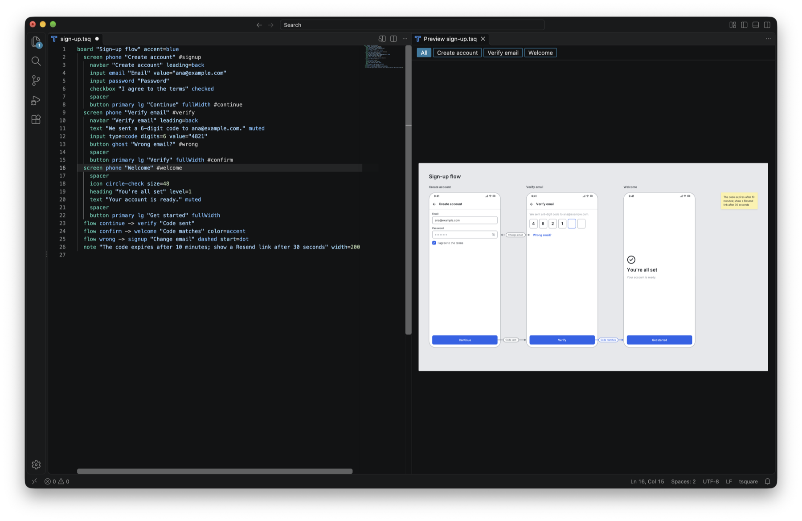
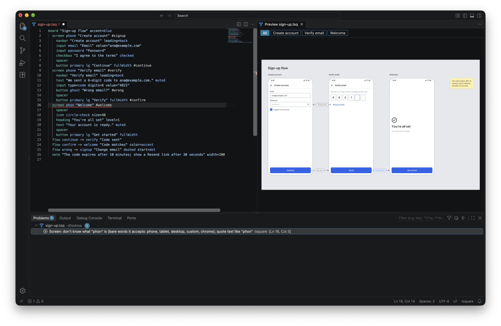
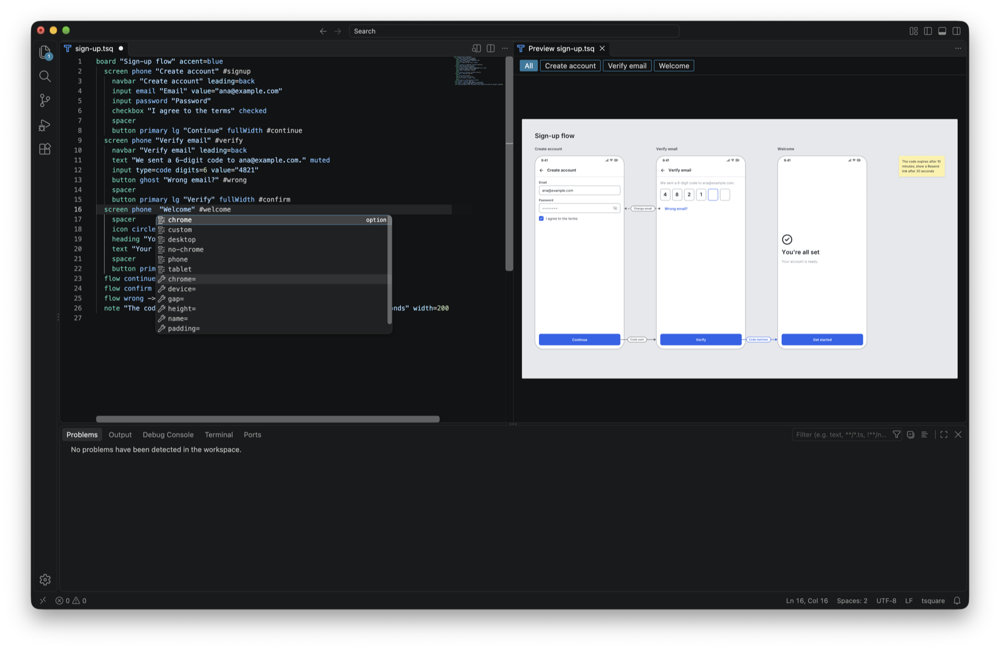

# tsquare for VS Code

Write [tsquare](https://tsquare.dev) wireframes in VS Code and see them as you type. tsquare is a small text language for UI wireframe boards: screens side by side, notes, flow arrows, in clean grayscale that drops into docs. It's easy for AI models to write, so this is also the quickest way to look at what one just wrote.



## Features

- **Live preview beside the editor.** Open it with **Cmd+K V** (Ctrl+K V on Windows and Linux) or the preview button in the editor's title bar, like Markdown's. It follows the `.tsq` file you're editing. Zoom with a pinch or Ctrl/Cmd + scroll, drag to pan, and click a screen's name to zoom to it. The zoom level is in the status bar; click it to fit the board.
- **Problems as you type.** Each mistake is underlined on its line and listed in the Problems panel, with a "did you mean" when there's a close match. While there are problems, the preview keeps the last board that worked.
  
- **Highlighting and autocomplete** for components, props, option values, icon names and colors. `#` comments toggle with Cmd+/.
  
- **Colors** set with `accent=#…` on the board, or `color=#…` on a flow, get a swatch and VS Code's color picker.
- **Export and share** from the preview's `…` menu or the Command Palette:
  - **Export SVG…** saves the board next to the file.
  - **Copy Image Link** copies a tsquare.dev image link that works anywhere an image does (Notion, GitHub, docs). Change `/svg/` to `/png/` in it for a PNG.
  - **Open in Playground** opens the wireframe in the tsquare.dev playground.

## Getting started

Create a file ending in `.tsq`, for example `login.tsq`:

```
board "Login"
  screen phone "Sign in"
    heading "Welcome back"
    input "Email" placeholder="you@example.com"
    input password "Password"
    button primary "Sign in" fullWidth
```

Press **Cmd+K V** to see it. The [docs](https://tsquare.dev/docs) cover the language and every component; the [playground](https://tsquare.dev/playground) has examples.

## Privacy

The preview, problems and SVG export run on your machine; nothing is sent anywhere. Copy Image Link and Open in Playground make tsquare.dev links that contain your wireframe's text, so opening one sends that text to tsquare.dev to render it. See the [privacy page](https://tsquare.dev/privacy).

## Links

- [tsquare docs](https://tsquare.dev/docs) and [playground](https://tsquare.dev/playground)
- [The tsquare library and CLI](https://github.com/tsquare-js/tsquare)
- [Issues](https://github.com/tsquare-js/tsquare-vscode/issues) and [contributing](https://github.com/tsquare-js/tsquare-vscode/blob/main/CONTRIBUTING.md)

## License

MIT. The extension bundles third-party packages; their licenses are in `dist/THIRD_PARTY_LICENSES.txt` inside the extension.
